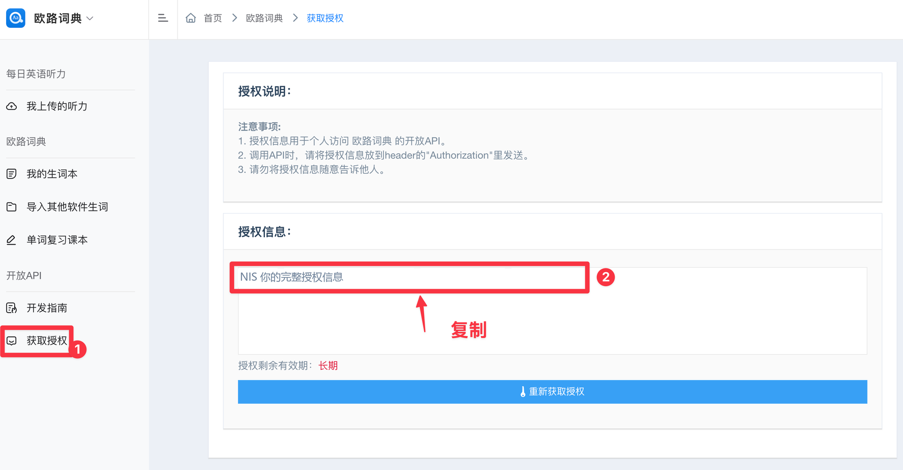

# Eudic Skills

欧路词典、法语助手、德语助手和西语助手的 Agent Skills 集合，可通过 AI 助手查询和管理个人学习数据。

## Skill 目录

| 名称 | 用途 | 前置条件 | 详情 |
| --- | --- | --- | --- |
| eudic-openapi-skills | 查询和管理个人生词本、语料、例句与笔记 | 支持 Agent Skills 的客户端、HTTP 执行能力、欧路个人授权 | [SKILL.md](skills/eudic-openapi-skills/SKILL.md) |

## 安装

### 从本仓库安装

可以将[本仓库](https://github.com/lulu-trans/eudic-skills)的地址发送给支持 Skill 安装的 AI 助手：

```text
请从这个 GitHub 仓库安装 eudic-openapi-skills：https://github.com/lulu-trans/eudic-skills
```

也可以在终端使用 Skills CLI 安装，需要 Node.js 22.20 或更新版本及 `npx`：

```bash
npx skills add lulu-trans/eudic-skills --skill eudic-openapi-skills
```

`--skill eudic-openapi-skills` 表示选择仓库内的这个 Skill，安装到 AI 客户端可识别的位置。仓库包含多个 Skill 时，可以按需选择。

按提示选择客户端，默认安装到当前项目；需要用户范围安装时追加 `-g`。安装其他 Skill 时，将 `--skill` 后的名称替换为目录表中的目标名称。[Skills CLI 官方说明](https://github.com/vercel-labs/skills)

### 手动安装

仅复制 `skills/eudic-openapi-skills/` 整个目录到客户端支持的 skill 目录。

OpenClaw 可放在 `<当前工作区>/skills/eudic-openapi-skills/` 或 `~/.openclaw/skills/eudic-openapi-skills/`。不要把仓库根目录当作一个 skill；复制后应能直接找到 `<安装目录>/eudic-openapi-skills/SKILL.md`。

## 授权与首次使用

1. 登录[欧路个人授权页面](https://my.eudic.net/OpenAPI/Authorization)，复制包含 `NIS ` 前缀的完整授权值。

   

2. 在执行 API 请求的环境中配置 `EUDIC_AUTHORIZATION`，原样使用页面复制的整段内容，保留自带的 `NIS ` 前缀，无需手动添加。
3. 明确要使用的语言：英语 `en`、法语 `fr`、德语 `de`、西班牙语 `es`。

将下面单引号内的中文提示替换为网页复制的完整内容，保留两侧单引号。

Bash 临时配置：

```bash
export EUDIC_AUTHORIZATION='在这里粘贴网页上的完整授权信息'
```

Windows PowerShell 临时配置：

```powershell
$env:EUDIC_AUTHORIZATION = '在这里粘贴网页上的完整授权信息'
```

以上变量仅作用于当前终端及之后启动的子进程。让助手或网关进程从该环境启动；已有进程需重新启动，远程或沙箱进程需在对应执行环境配置。不要把真实授权写入本仓库或共享聊天。

首次发送只读请求：

```text
使用 eudic-openapi-skills，从 EUDIC_AUTHORIZATION 读取授权，列出我的英语生词本名称和 ID。只查询，不修改数据，不输出授权信息。
```

## 使用示例

以下示例适用于 `eudic-openapi-skills`。配置授权后，直接把提示词发给助手即可；如果没有自动使用 Skill，可以在开头加上“使用 eudic-openapi-skills”。

**说清楚应用或语言、目标生词本、筛选范围和希望看到的结果**，不用自己查分类 ID 或填写接口参数。将示例中的“阅读积累”、单词和日期范围换成自己的需求即可。

### 查看生词本，找到操作目标

还不确定有哪些分类时，先让助手列出已有生词本。

> 列出我在法语助手中的生词本，显示名称和 ID。只查询，不修改数据。

**预期结果：** 返回当前账号的法语生词本列表。接下来可以直接用名称指定目标，例如“查看‘阅读积累’里的单词”。

### 浏览单词，带着语境复习

指定生词本、数量和展示内容，先看一小批，再按需要继续。

> 查看我的英语生词本“阅读积累”中的前20个单词，按“单词、释义、已有语境”整理展示。

**预期结果：** 展示已有单词及其释义、语境；未保存语境的条目会说明缺失，不把临时生成的例句当成原始记录。

### 批量添加单词

将阅读或练习中遇到的单词一次性收藏到指定生词本。

> 把 apple、banana、orange 添加到我的英语生词本“阅读积累”。先查找目标生词本，完成后告诉我操作结果；如果没有这个生词本，先列出已有分类让我选择。

**预期结果：** 使用真实分类完成批量添加，并报告服务返回的结果；不会把示例名称或 ID 当成已存在的数据。

### 创建和重命名生词本

按学习主题建立分类，或调整已有分类的名称。

> 在法语助手中创建一个叫“旅行法语”的生词本。如果已经有同名生词本，直接告诉我，不重复创建。

需要重命名时，可以这样说：

> 把法语助手中的生词本“旅行法语”重命名为“旅行与日常”，保留其中的单词。

**预期结果：** 创建时返回新分类的信息；重命名只修改分类名称。如果名称对应多个分类，会先让你选择具体目标。

### 筛选最近语料，找出尚未收藏的词

明确时间、收藏状态和数量，减少无关结果。

> 查看我最近7天的法语语料，只看尚未收藏到生词本的条目，先返回前20条，保留已有的释义和原文上下文。

**预期结果：** 返回符合条件的个人语料。还有更多结果时，可以继续说“查看下一页”，直到满足需要或达到查询上限。

### 找回单词笔记

用单词和语言定位已保存的个人记录。

> 查询我给 hello 保存的英语笔记，展示原文，不修改内容。

**预期结果：** 展示已有笔记；没有记录时明确告诉你，不自动生成一份笔记冒充查询结果。

### 保存笔记，保留对旧内容的选择

说明要保存的内容，也可以指定覆盖或保留旧笔记的方式。

> 给英语 hello 保存笔记“常用于打招呼”。如果已有笔记，先展示旧内容，等我决定是否覆盖。

**预期结果：** 没有旧笔记时保存新内容；已有笔记时等待你的决定，再执行覆盖。保存笔记不会自动把单词加入生词本。

### 查看已收集的例句

单独回顾收藏过的句子、翻译和备注。

> 列出我收集的西班牙语例句，先返回前20条，保留已有翻译和备注。

**预期结果：** 展示个人收藏的例句及已保存的信息；不额外写入或修改记录。

### 完整任务：从阅读文章到收藏生词

也可以把“阅读、挑词、确认、收藏”串成一次任务，先看候选结果，再决定保存哪些内容。

> 阅读下面的英语文章，挑出10个值得学习的单词，解释它们在原文中的含义，并保留对应原句。先把候选词列给我；我确认后，再把选中的单词连同原句添加到英语生词本“阅读积累”。
>
> 文章：在这里粘贴正文。

看到候选词后，可以继续回复：

> 只收藏第2、4、6个单词，保留对应原句，其他候选词不要写入。

**预期结果：** 第一轮只整理候选词；确认后才收藏选中的条目，并告知操作结果。临时生成的解释与已保存的个人数据会明确区分。

### 在同一会话中继续调整

不必每次重写完整需求，可以接着补充范围或展示方式：

- “查看下一页。”
- “只看前10条，保留上下文。”
- “换成法语助手，先列出那边的生词本。”
- “把刚才查到的内容整理成 Markdown，方便我复制。”

Skill 查询的是你自己的生词本、语料、笔记和例句。授权失败或遇到限流时先停止请求，核对授权或按服务提示等待。更多授权步骤和常见问题见[官网使用指南](https://my.eudic.net/OpenAPI/Doc_Skills)。

## 仓库结构与新增 Skill

```text
eudic-skills/
├── README.md
├── docs/
│   └── images/
│       └── skill-authorization.png
└── skills/
    └── eudic-openapi-skills/
        └── SKILL.md
```

新增 skill 的约定：

- 放在 `skills/<skill-name>/SKILL.md`，目录名与 YAML frontmatter 的 `name` 一致，使用小写字母、数字和连字符。
- `description` 写清能力与适用任务，正文只放实际执行需要的流程、约束和例子。
- skill 必须自包含：只安装该目录就能使用，不依赖根 README、兄弟 skill 或网站项目源码。可以直接链接必要的官方在线文档。
- 仅在有实际用途时，在该目录内增加 `references/`、`scripts/` 或 `assets/`，并从 `SKILL.md` 说明如何使用；不预建空目录或共享依赖层。
- 在根目录表中登记用途、前置条件和详情链接，安装示例明确选择目标 skill。

格式依据：[Agent Skills 规范](https://agentskills.io/specification)、[Skills CLI 创建与发现说明](https://github.com/vercel-labs/skills/blob/main/docs/creating-skills.md)。

